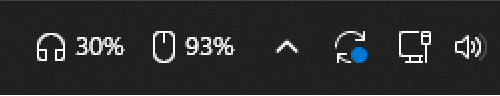

# 无线设备电量监视器 CN · Wireless-Device-Battery-Monitor-CN

把无线鼠标、耳机、键盘和手柄的电量直接显示在 Windows 任务栏上，不装厂商软件、不要管理员权限、没有后台服务。



<sub>上图是上游原版的并排显示截图；本分支默认改为「一次只显示一个设备」（可在右键菜单关闭），详见下方改动清单。</sub>

这是 **Wireless Battery** 的简体中文本地化分支：界面默认中文、词条经过逐条校订、安装包与项目名改为 `Wireless-Device-Battery-Monitor-CN`，其余程序逻辑与上游保持一致。

---

## 与上游项目的关系

| 项目 | 说明 |
| --- | --- |
| 原项目 | **Wireless Battery** |
| 原作者 | **krisgfx**（GitHub：[@krisgfx9](https://github.com/krisgfx9)） |
| 原仓库 | <https://github.com/krisgfx9/Wireless-Device-Battery-Monitor> |
| 原项目协议 | GNU GPLv3 或更高版本 |
| 本分支 | 简体中文本地化 + 中文安装包，同样以 GPLv3 发布 |

本仓库**不是**原作者维护的官方版本。遇到上游逻辑问题请对照原仓库；中文界面、翻译措辞、打包方式相关的问题请提到本仓库。

### 修改声明（GPLv3 第 5 条）

本仓库是 <https://github.com/krisgfx9/Wireless-Device-Battery-Monitor> 的**修改版本**，按 GNU GPLv3 第 5 条在此显著声明：

- **修改人**：fuyue521（<https://github.com/fuyue521>），修改日期 2026-11-18。
- **修改内容**：简体中文本地化、默认语言与版本资源中文化、任务栏挂件的单设备显示与滚轮切换、打包方式（NSIS）。逐条清单见下方「本分支相对上游的改动」。
- **修改性质**：仅修改与新增，未删除上游功能；上游源码文件头部的版权声明、`LICENSE` 文件均保持原样。
- **历史记录**：上游的完整 Git 提交历史（含每位作者的原始提交）原样保留在本仓库中，`git log` 即可查看；本分支的改动以上游最后一次提交（`958a60a`）为基线，其后 6 个提交的作者为本仓库修改人。
- **许可**：本项目整体仍以 GNU GPLv3（或更高版本）发布，完整对应源码即本仓库；原作者与上游贡献者名单见 [CONTRIBUTORS.md](CONTRIBUTORS.md)。

### 本分支相对上游的改动

- **界面默认简体中文**：未保存过语言选择时回退到 `zh-CN`（中文 Windows 本来就是中文，现在英文系统上也是中文）。
- **词条校订**：`lang/zh-CN.txt` 全部 97 条逐条校对，统一标点（中文省略号/引号）、术语（"接收器""挂件""开机启动"）和语气。
- **残留硬编码汉化**：托盘提示前缀、报告窗口标题改为中文产品名。
- **版本资源中文化**：文件描述、产品名改为中文/CN 版名称。
- **安装包重做**：Inno Setup 脚本换成 NSIS 脚本，中文安装向导、免管理员、按用户安装，产物为 `Wireless-Device-Battery-Monitor-CN-Setup-1.0.0.exe`。
- **挂件只显示一个设备**：设备多于一个时，任务栏挂件默认只显示当前设备（不再向右挤占任务按钮），鼠标悬停时滚轮上下切换，切换带左右滑动淡入淡出动画；右键菜单可关掉这项，恢复上游的并排显示。
- **文档中文化**：本 README 与安装目录内的 `README.txt`。

> 驱动、协议解析、命令行行为均未改动；界面层只改了语言默认值、挂件显示方式与文案。

---

## 功能

- **挂件 / 托盘双模式**：图标加百分比紧贴时钟左侧；挂件不可用时自动回退托盘图标，低电量弹出通知。
- **5 秒轮询**：默认每 5 秒刷新一次，插拔设备或系统唤醒后立即补刷；设备休眠时变暗并保留上次电量。
- **电量颜色与充电指示**：低于 20% 数字标红，≤15% 触发低电量提醒。充电时耳机数字与闪电同显，其余非耳机设备只留闪电；手机按电量回升趋势推测充电，充电时数字显绿色、不画闪电。
- **单设备显示**：多设备时挂件默认只显示当前设备，滚轮上下切换，带左右淡入淡出；右键可恢复全部并排。
- **固定尺寸**：挂件宽度不随电量位数、设备类型或充电状态变化，等宽数字左对齐。
- **同类设备区分**：两只鼠标/手柄在角上标短标签；真无线耳机双耳合并取最低电量，充电仓单独一条。
- **显示选项**：15 套品牌配色（Razer 绿、Logitech 蓝、SteelSeries 橙……）、多显示器分别显示、图标压在百分比上方、透明任务栏底色板。
- **设备覆盖**：罗技/雷蛇/赛睿/海盗船/HyperX 等键鼠耳机，Xbox/PS/Switch/八位堂等手柄，Galaxy Buds/AirPods/JBL 等 TWS，以及 AULA、Kysona、ATK、MCHOSE、雷柏等国产键鼠私有协议；蓝牙设备直读系统电量，手机经 GATT 直读实时电量。
- **右键菜单**：逐设备显示/隐藏/排序、立即刷新、开机启动、语言切换、选择显示器、退出。
- **多语言**：内置 13 种语言（简繁中文、英、德、西、法、日、俄、波兰、巴西葡语、土耳其、阿拉伯、希伯来），也可放入自定义词条文件即时生效。

## 支持设备

| 类别 | 覆盖范围 |
| --- | --- |
| 罗技 | HID++ 1.0/2.0 鼠标与键盘、G435 等耳机 |
| 雷蛇 | 鼠标、键盘、耳机（含 Barracuda） |
| 赛睿 / 海盗船 / HyperX / Astro / NZXT / 美商海盗船 | 鼠标、耳机、底座 |
| 游戏手柄 | Xbox、PlayStation DualSense/DualShock、Switch Pro、Steam Controller、八位堂、飞智、北通、盖世小鸡 |
| 真无线耳机 | Galaxy Buds、AirPods、Jabra、JBL、漫步者（部分）、水月雨 |
| 蓝牙设备 | 任何 Windows 能报电量的蓝牙外设 |
| 手机 | 通过 Phone Link 连接的手机电量 |
| 国产键鼠 | ATK/VXE、MCHOSE、Rapoo、Kysona、Pulsar、G-Wolves、Endgame、VAXEE、WLmouse、Finalmouse、AULA、SONiX、Redragon/Areson、Delux/Ajazz、Attack Shark、达尔优、雷柏等 |

完整型号清单见源码 `src/drivers/` 下各驱动的注释（每个文件头部都标注了协议出处）。

## 安装

### 方式一：安装包（推荐）

1. 下载 `Wireless-Device-Battery-Monitor-CN-Setup-1.0.0.exe`（见 Releases）。
2. 双击运行，按中文向导下一步即可；**不需要管理员权限**，默认安装到
   `%LOCALAPPDATA%\Programs\Wireless-Device-Battery-Monitor-CN`。
3. 安装器可选择"开机自动启动"，装完可直接启动；卸载在"设置 → 应用"里。

安装包内附带 `headsetcontrol.exe`（HeadsetControl 4.3.0，用于部分耳机），请与主程序保持同目录。

### 方式二：便携版

把 `WirelessBattery.exe`、`headsetcontrol.exe`、`LICENSE.txt`、`THIRD_PARTY_NOTICES.txt` 放到任意目录直接运行即可，不写系统目录。

> `headsetcontrol.exe` 不是可选项：走 `[HeadsetControl]` 通道的耳机（例如 MCHOSE V9 Pro、Arctis Nova、部分 HyperX/Jabra/Astro）依赖主程序**同目录**下的它来读电量。缺了这个文件，这些设备会直接在列表里消失，其它鼠标/蓝牙设备不受影响。

## 使用

- 首次启动后任务栏出现挂件；右键托盘图标可切换"任务栏挂件"与"托盘图标"两种模式。
- 想单独隐藏某个设备：右键 → 指向该设备 → "在任务栏显示/在托盘中显示"。
- 语言：右键 → "语言" → 简体中文 / 自动（跟随 Windows 语言）/ 其他。
- 显示器：右键 → "挂件显示在" → 所有显示器 / 仅主显示器 / 指定某块屏。
- 多个设备时挂件只显示一个：把鼠标移到挂件上，**滚轮向上 = 上一个设备，向下 = 下一个设备**；
  不想这样可在右键菜单里取消勾选"一次只显示一个设备（滚轮切换）"，改回全部并排显示。

## 命令行

| 命令 | 作用 |
| --- | --- |
| `WirelessBattery.exe --list` | 列出检测到的设备与电量（控制台输出，英文） |
| `WirelessBattery.exe --dump` | 导出 HID 调查信息，反馈兼容性问题时附上 |
| `WirelessBattery.exe --report` | 打开"申请支持某个设备"窗口 |
| `WirelessBattery.exe --demo` | 用演示数据预览挂件外观 |
| `WirelessBattery.exe --quit` | 退出正在运行的实例 |

## 构建

需要 C++17 编译器（MSYS2 MinGW-w64 或任何支持 Win32 的 g++），无第三方库。

```bat
:: cmd / MSYS2，产出 WirelessBattery.exe
build.bat
```

或使用 Makefile：

```bash
make          # 编译
make test     # 编译并运行 20 个单元测试（协议字节解析等）
make clean
```

资源（图标、清单、13 种语言）由 `windres` 编译进 exe，编译参数与上游一致：`-std=c++17 -Os -static -s`。

## 打包安装程序

```bat
:: 1) 先构建出 WirelessBattery.exe
build.bat
:: 2) 生成 dist\Wireless-Device-Battery-Monitor-CN-Setup-1.0.0.exe
installer\build-installer.cmd
```

脚本会校验 `third_party\headsetcontrol\headsetcontrol.exe` 的 SHA-256（`e371da04…`），不符则中止；首次运行会自动下载 HeadsetControl 4.3.0。

安装脚本 `installer/Wireless-Device-Battery-Monitor-CN.nsi` 使用 NSIS 3.x（`winget install NSIS.NSIS`），中文界面、`RequestExecutionLevel user`、LZMA 压缩。

## 目录结构

```
Wireless-Device-Battery-Monitor-CN/
├─ src/                 Win32 主体：任务栏挂件、托盘、菜单、i18n
│  └─ drivers/          72 个厂商驱动（只读电量协议）
├─ lang/                13 种语言词条（zh-CN.txt 为中文）
├─ res/                 图标、清单、版本资源
├─ tests/               20 个单元测试
├─ installer/           NSIS 安装脚本 + 构建脚本 + 第三方声明
├─ docs/                截图与协议笔记
├─ linux/              实验性 Linux 版（GTK4 托盘）
├─ Makefile / build.bat
└─ README.md
```

## 翻译

界面词条是纯文本的 `lang/*.txt`，格式为 `英文原文 = 译文`，支持 `{name}`、`{percent}` 具名占位符。
想改中文措辞直接编辑 `lang/zh-CN.txt`；想加语言复制 `lang/_template.txt` 改名即可。
把文件放进 `%APPDATA%\WirelessBattery\lang` 可以覆盖内置词条，无需重新编译。

## 已知限制

- 只读查询：驱动不会向设备写入任何数据（HeadsetControl 外）。
- 某些设备在休眠/关机后只能读到上次缓存电量。
- 2.4 GHz 私有协议设备依赖厂商 dongle 提供的 HID 接口，部分型号会随固件变化。
- 报告窗口的"发送"是唯一联网动作，且只在用户点击后发生。

## 许可与致谢

- 本分支与上游一致，以 **GNU GPLv3 或更高版本** 发布，见 [LICENSE](LICENSE)。
- 原作者 **krisgfx**（bimbikri）与所有上游贡献者：<https://github.com/krisgfx9/Wireless-Device-Battery-Monitor>
- 上游贡献者完整名单（共 96 人）与各自角色：[CONTRIBUTORS.md](CONTRIBUTORS.md)
- 随附 [HeadsetControl](https://github.com/Sapd/HeadsetControl) 4.3.0（GPLv3），版权归其贡献者，见 [THIRD_PARTY_NOTICES.txt](installer/THIRD_PARTY_NOTICES.txt)。
- 图标作者 nik-txt；各品牌协议细节来源于 HeadsetControl、OpenRazer、Solaar、rivalcfg 等开源项目的公开逆向成果（详见各驱动文件头注释）。

## 上传到 GitHub

```bash
cd Wireless-Device-Battery-Monitor-CN
git init
git add .
git commit -m "简体中文本地化：默认中文界面、词条校订、NSIS 中文安装包"
git branch -M main
git remote add origin https://github.com/<你的用户名>/Wireless-Device-Battery-Monitor-CN.git
git push -u origin main
```

`.gitignore` 已排除 `*.exe`、`dist/`、`build/`、`third_party/`，因此仓库里只有源码；安装包请作为 Release 附件上传。
建议在仓库描述里写清："Simplified Chinese fork of krisgfx/Wireless-Device-Battery-Monitor"。
